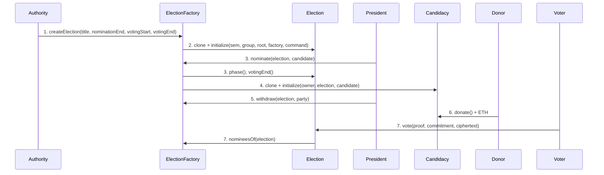
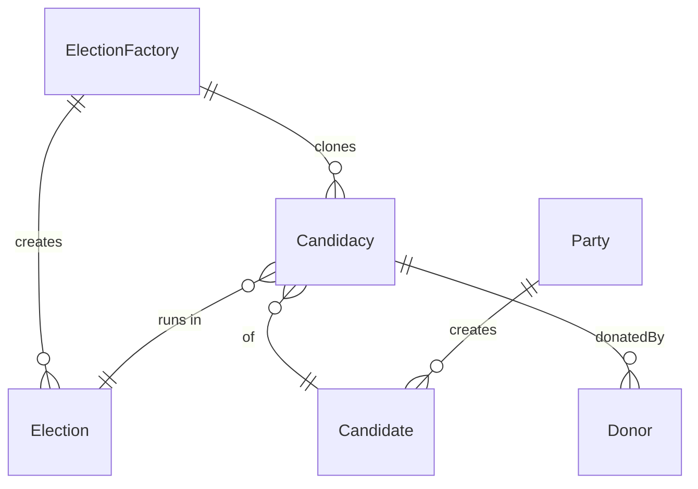
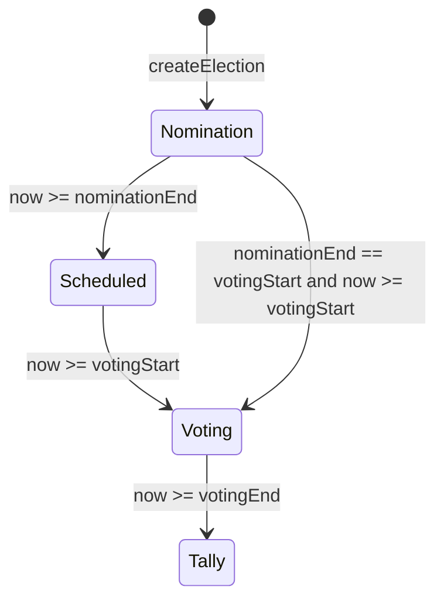
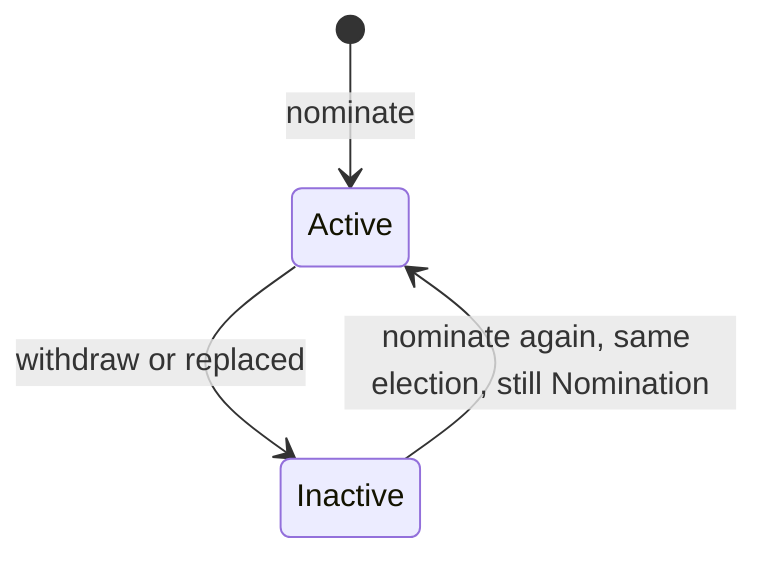

# Candidacy

**Approved**: 2026-11-21 - user: "implemente"
**Settled mid-build:** none
**Review:** <pending>
**Fix pass:** <pending>

## Problem

Today an election carries its candidates as a plain `string[]` typed by the authority at creation. Those names have no link to the `Candidate` contracts that parties create, so a party cannot choose who runs for it, the same person can appear in any number of elections at once, nobody can donate to a person's run in a specific election, and the authority decides the ballot alone. Evidence: the request gives none beyond the ask.

When this ships, an election opens with a nomination period in which each party's president publishes one of the party's candidates; each nomination is a `Candidacy` contract (election + candidate) that can receive donations and whose balance the candidate's wallet withdraws; the ballot is the list of nominees; a candidate cannot be nominated to a second election while the first has not reached its tally phase; and the authority no longer types candidate names.

## Shape

Reuses `DonationHolder`/`IDonatable` (donate, withdraw, `Ownable2Step`), the EIP-1167 clone + `initialize` pattern of `Election`/`Party`/`Candidate`, the factory-trust pattern (`isElection`, `isParty`, `Party.isCandidate`, `Candidate.party`), `Party.owner()` as the president, `onlyInPhase`, and in the frontend `DonateCard`/`WithdrawCard`, `runTransaction` and the election form validation. Every rule lives in Solidity and is covered by the Solidity tests in `packages/contracts/test/`; the frontend rules (form validation, phase from timestamps, who may nominate) are pure functions covered by vitest in `packages/frontend/test/`.

Terms: `Candidacy` is the n:n association itself, one clone per (election, candidate) pair; `ElectionFactory` creates them, lists them per election and knows which election holds each candidate. The new election phase is `Nomination`, to keep it apart from the contract.

1. authority calls `ElectionFactory.createElection(command)` where the command now has `nominationEnd` and no names -> `ElectionFactory` (exists) - passes its own address to the new clone's `initialize`
2. `Election` (exists) - validates `now < nominationEnd <= votingStart < votingEnd`, stores `nominationEnd` and the factory address; `phase()` gains `Nomination`
3. president calls `ElectionFactory.nominate(election, candidate)` -> `ElectionFactory` (exists) - checks election and party belong to the factory, `msg.sender` is `Party.owner()` of the candidate's party, `election.phase()` is `Nomination`, the candidate is free; creates (or reuses) the `Candidacy` clone of that (election, candidate) pair, marks it active, makes it the party's nominee (replacing a previous one) and holds the candidate until `election.votingEnd()`
4. `ElectionFactory` (exists) -> `Candidacy` (new) - `initialize(owner = candidate wallet, election, candidate, factory)` runs once per clone
5. president calls `ElectionFactory.withdraw(election, party)` -> `ElectionFactory` (exists) - same checks; removes the party's nominee, deactivates its `Candidacy` (balance stays), frees the candidate
6. donor calls `Candidacy.donate()` / candidate wallet calls `Candidacy.withdraw(to, amount)` -> `Candidacy` (new) via `DonationHolder` - donate only while active; withdraw always
7. voter calls `Election.vote` / anyone calls `revealBatch` / `results` -> `Election` (exists) - reads the ordered nominee list (`Candidacy[]`) from the factory, frozen once `nominationEnd` passes; the option index of a vote is the position in that list, an option past the end is a null vote
8. reader opens `/elections/:address` -> election route (exists) - reads `candidacies()`, each `Candidacy`'s candidate name and party, balance; president sees "Indicar candidato" during `Nomination`; donate and withdraw forms per nominee

**Changes underneath**

| Front | What changes |
| --- | --- |
| domain | "candidatos da eleição" meant a string list typed by the authority, now means the `Candidacy` nominees; `ElectionPhase` gains `Nomination` at value 0 (`Scheduled`, `Voting`, `Tally` shift by one). Who branches on it today: `Election.phase`, the `onlyInPhase` uses, `phase.ts`, `election-stats`, `results-card`, tests. `DonationHolder.donate` becomes `virtual` so `Candidacy` can refuse inactive donations; its ABI is unchanged |
| stored data | nothing to migrate: `Election.sol` and `ElectionFactory.sol` have new bytecode, so the factory must be redeployed and `VITE_FACTORY_ADDRESS` updated (operator action); existing elections stay on the old factory |
| readers | create-election form loses the names and gains the nomination deadline; election page shows phase "Indicação de candidatos", the nominees (name, party, balance) in the vote card, ballots, reveal panel and results; new "Indicar candidato" card; donate and withdraw per nominee; `abis.ts` gains `candidacyAbi` and `electionFactoryAbi` gains the nomination functions; `CreateElectionCommand.candidates`, `Election.candidates()` as `string[]` and `InvalidCandidatesQuantity` are removed |

New: `Candidacy` (the n:n between `Election` and `Candidate`), the Election -> Candidacy and Candidate -> Candidacy relations. One-way constraints: the nominee list order is the option index of a vote (door 1); `Candidacy` is an EIP-1167 clone initialised once and `ElectionFactory` is its sole creator (door 2); at most one `Candidacy` per (election, candidate) (door 3).

## Surface

Contract calls (200 success, 403 revert for a caller who may not call, 400 other revert) and SPA routes.

| Route | In | Out | Status | Who |
| --- | --- | --- | --- | --- |
| `ElectionFactory.createElection(CreateElectionCommand{title, nominationEnd, votingStart, votingEnd})` | command | `Election` | 200; 403 `OwnableUnauthorizedAccount`; 400 `InvalidNominationEnd`, `InvalidVotingStart`, `InvalidVotingDuration` | the factory owner; others get 403 |
| `ElectionFactory.nominate(Election election, Candidate candidate)` | election, candidate | `Candidacy`; event `Nominated(election, party, candidate, candidacy)` | 200; 403 `NotPartyPresident`; 400 `UnknownElection`, `UnknownCandidate`, `InvalidPhase`, `AlreadyNominated`, `CandidateBusy` | the president of the candidate's party; others get 403 |
| `ElectionFactory.withdraw(Election election, Party party)` | election, party | event `NominationWithdrawn(election, party, candidate, candidacy)` | 200; 403 `NotPartyPresident`; 400 `UnknownElection`, `UnknownParty`, `InvalidPhase`, `NotNominated` | the president of `party`; others get 403 |
| `ElectionFactory.nomineesOf(election)` / `nomineeOf(election, party)` / `candidacyOf(election, candidate)` / `isActive(candidacy)` / `heldBy(candidate)` | - | `Candidacy[]` / `Candidacy` / `Candidacy` / `bool` / `Election` | 200 | anyone |
| `Candidacy.donate()` payable | ETH | event `Donated` | 200; 400 `ZeroDonation`, `NominationInactive` | anyone |
| `Candidacy.withdraw(address to, uint256 amount)` | to, amount | event `Withdrawn` | 200; 403 `OwnableUnauthorizedAccount`; 400 `InvalidRecipient`, `InsufficientBalance`, `WithdrawFailed` | the candidate wallet; others get 403 |
| `Candidacy.election()` / `candidate()` / `party()` | - | `Election` / `Candidate` / `Party` | 200 | anyone |
| `Election.nominationEnd()`, `Election.factory()`, `Election.candidates()` | - | `uint64`, `ElectionFactory`, `Candidacy[]` | 200 | anyone |
| `/elections/:address` (nominees, donate, withdraw, "Indicar candidato") | - | page | 200; existing "não encontrada" screen | anyone; withdraw form only for the candidate wallet; nominate card only for a president |

## Landing

| One-way door | Literal shape | Alternative rejected |
| --- | --- | --- |
| Option index of a vote | `option` = position in `ElectionFactory.nomineesOf(election)`; replacing keeps the position, withdrawing swaps the last nominee into the freed position; the list is frozen from `nominationEnd` on; option `>= length` is a null vote | indexing by party creation order - a party without a nominee would leave holes in the ballot |
| Contract split | `ElectionFactory` holds `address private immutable _candidacyBase = address(new Candidacy())`, clones it in `nominate` and runs `initialize(candidateWallet, election, candidate, address(this))`; `Candidacy is DonationHolder` with `_disableInitializers()`; no separate registry contract (user: "faça tudo no ElectionFactory") | a separate registry contract - rejected by the user; one global contract with per-pair balances - duplicates donate/withdraw and the user chose clones |
| One clone per pair | `candidacyOf[election][candidate]` is created once and reused when the same candidate is nominated again to the same election; withdrawing only flips `isActive` | a new clone per nomination - donors of an earlier nomination would be orphaned on a second address |
| Election tally storage | `mapping(uint256 option => uint256) private _votes` replaces `uint256[] _tally`; `results()` still returns `uint256[]` sized to the nominee count | pushing zeros at `initialize` - the count is unknown until `nominationEnd` |

- Nothing else in this change is hard to reverse

## Criteria

### S1: A president nominates a candidate during the nomination phase (P1)

**Acceptance Criteria**

1. WHEN the factory owner calls `createElection` with `nominationEnd` > now, `nominationEnd` <= `votingStart` and `votingStart` < `votingEnd` THEN the election SHALL store `nominationEnd` and the factory address, and `phase()` SHALL be `Nomination`
   - `nominationEnd == votingStart` → accepted; `nominationEnd == now` → `InvalidNominationEnd`
2. IF `nominationEnd` <= `block.timestamp` or `nominationEnd` > `votingStart` THEN `initialize` SHALL revert with `InvalidNominationEnd` (checked after `InvalidVotingStart` and `InvalidVotingDuration`)
3. The election SHALL NOT take candidate names in `CreateElectionCommand`, SHALL have no `InvalidCandidatesQuantity`, and SHALL accept an election that has no nominee
4. WHEN `phase()` is read THEN it SHALL be `Nomination` while now < `nominationEnd`, `Scheduled` while `nominationEnd` <= now < `votingStart`, `Voting` while `votingStart` <= now < `votingEnd`, and `Tally` from `votingEnd`
5. WHEN the president of a party calls `nominate(election, candidate)` with an election of the factory in phase `Nomination` and a candidate created by that party THEN the factory SHALL clone a `Candidacy` with `owner()` equal to `candidate.owner()`, `election()`, `candidate()` and `party()` set, record it as the party's nominee, make `nomineesOf(election)` end with it, set `isActive` true, `candidacyOf(election, candidate)` to it, `heldBy(candidate)` to the election and emit `Nominated(election, party, candidate, candidacy)`
6. IF `msg.sender` is not `Party.owner()` of the candidate's party THEN `nominate` SHALL revert with `NotPartyPresident`
7. IF `election` is not in the factory's `isElection` THEN `nominate` SHALL revert with `UnknownElection`
8. IF the candidate's `party()` is not in the factory's `isParty`, or that party's `isCandidate(candidate)` is false THEN `nominate` SHALL revert with `UnknownCandidate` (a hand-deployed `Candidate` claiming a real party is rejected)
9. IF the election is not in phase `Nomination` THEN `nominate` SHALL revert with `InvalidPhase(current, Nomination)`
   - at `nominationEnd - 1` → accepted; at `nominationEnd` → `InvalidPhase(Scheduled, Nomination)`
10. WHEN two parties nominate for the same election THEN `nomineesOf(election)` SHALL list both `Candidacy` in nomination order and `nomineeOf(election, party)` SHALL return each
11. WHEN `Election.candidates()` is called THEN it SHALL return `nomineesOf(election)`; the `string[]` is gone
12. IF `initialize` is called again on a `Candidacy` clone, or on the `Candidacy` implementation, THEN it SHALL revert with `InvalidInitialization` and `owner()`, `election()`, `candidate()` SHALL stay unchanged
13. WHEN `pnpm contracts:export-abis` runs THEN `abis.ts` SHALL export `candidacyAbi`, and `electionAbi`/`electionFactoryAbi` SHALL carry the new signatures

### S2: A party replaces or withdraws its nominee, and a candidate runs in one election at a time (P1)

**Acceptance Criteria**

14. WHEN a party whose nominee is A nominates B (same party) in the same election during `Nomination` THEN `nomineeOf` SHALL be B's `Candidacy` at A's position in the list, A's `Candidacy` SHALL become inactive, `heldBy(A)` SHALL be the zero address, `heldBy(B)` SHALL be the election and the event SHALL be `Nominated`
15. IF the party nominates the candidate who is already its active nominee in that election THEN `nominate` SHALL revert with `AlreadyNominated`
16. WHEN the president calls `withdraw(election, party)` during `Nomination` THEN the factory SHALL remove the nominee, set its `Candidacy` inactive, free the candidate (`heldBy` zero), keep the other nominees in order (the last takes the freed position) and emit `NominationWithdrawn(election, party, candidate, candidacy)`
17. IF `withdraw` is called by someone who is not `Party.owner()` of `party` THEN it SHALL revert with `NotPartyPresident`; IF `party` is not in the factory's `isParty` THEN `UnknownParty`; IF `election` is unknown THEN `UnknownElection`; IF the party has no nominee in that election THEN `NotNominated`; IF the phase is not `Nomination` THEN `InvalidPhase(current, Nomination)`
18. IF a candidate is `heldBy` an election whose `votingEnd` is still in the future and `nominate` names a different election THEN it SHALL revert with `CandidateBusy(heldElection)`
    - held by E1 (`votingEnd` tomorrow), nominate to E2 → `CandidateBusy(E1)`; E1 withdrawn → accepted; E1 replaced by another candidate → accepted
19. WHEN the election that holds a candidate reaches `votingEnd` (phase `Tally`) THEN a nomination of that candidate to another election SHALL be accepted
    - at `votingEnd - 1` → `CandidateBusy`; at `votingEnd` → accepted
20. WHEN a candidate withdrawn from an election is nominated again to the same election during `Nomination` THEN the factory SHALL reuse the existing `Candidacy` (same address, balance and `donatedBy` kept) and set it active; a party SHALL never have two active nominees in one election
21. WHILE the phase is not `Nomination` the nominee list of an election SHALL NOT change: `nominate` and `withdraw` revert with `InvalidPhase`

### S3: Votes and the tally follow the nominee list (P1)

**Acceptance Criteria**

22. WHEN a voter calls `vote` THEN the existing rules SHALL hold and the phase check SHALL still be `Voting`; the other phases (including `Nomination` and `Scheduled`) revert with `InvalidPhase(current, Voting)`
23. WHEN `revealBatch` reveals an option below `candidates().length` THEN the tally of that position SHALL grow by one; an option at or above the length SHALL grow `nullVotes`
    - 2 nominees: option 1 → tally[1]; option 2 → nullVotes
24. WHEN `results()` is called THEN it SHALL return a tally array with one entry per nominee in list order, `nullVotes` and the unrevealed count; an election with no nominee SHALL return an empty tally and every vote SHALL be null
25. The existing Solidity and TypeScript contract tests SHALL keep their assertions about voting, reveal, tally and factory behaviour, adapted only to nominate candidates through the factory and to the new phase and command (no assertion about `string[]` remains)
26. IF `revealBatch` is called while the phase is not `Tally` THEN it SHALL still revert with `InvalidPhase(current, Tally)`

### S4: Donations to a candidacy (P1)

**Acceptance Criteria**

27. WHEN any account calls `Candidacy.donate()` with `msg.value` > 0 on an active candidacy THEN it SHALL add the value to `donatedBy(donor)`, raise the balance and emit `Donated(donor, msg.value)`
    - 1 wei → accepted; 1 ETH then 2 ETH by one donor → `donatedBy` = 3 ETH
28. IF `donate()` is called with `msg.value` = 0 THEN the candidacy SHALL revert with `ZeroDonation`
29. IF `donate()` is called on an inactive candidacy (withdrawn or replaced nomination) THEN it SHALL revert with `NominationInactive`, and the balance and `donatedBy` SHALL stay unchanged
30. IF ETH is sent to a candidacy without `donate()` (plain transfer or unknown calldata) THEN it SHALL revert
31. WHEN the candidate wallet (`owner()`) calls `Candidacy.withdraw(to, amount)` with `amount` <= balance THEN it SHALL send `amount` wei to `to`, emit `Withdrawn(to, amount)` and keep `donatedBy`; this SHALL work also while the candidacy is inactive
    - amount = balance → balance 0; amount = 0 → accepted; withdrawn nomination with balance → still withdrawable
32. IF a non-owner calls `Candidacy.withdraw` (including the party's president, unless it is also the candidate wallet) THEN it SHALL revert with `OwnableUnauthorizedAccount`; IF `amount` > balance THEN `InsufficientBalance`; IF `to` is zero THEN `InvalidRecipient`; IF the transfer fails THEN `WithdrawFailed` with the balance unchanged
33. IF `renounceOwnership()` is called on a candidacy THEN it SHALL revert with `RenounceDisabled`
34. The `Party` and `Candidate` ABIs for `donate`, `donatedBy`, `withdraw` and their existing tests SHALL be unchanged by making `donate` virtual

### S5: The authority creates an election and everyone sees the nominees (P1)

**Acceptance Criteria**

35. WHEN the authority opens the create-election card THEN it SHALL show title, "Fim das indicações", "Início da votação" and "Fim da votação" fields and no candidate-name fields; defaults: nominations close in ~10 min, voting starts 5 min after, one hour of voting (all multiples of 5 min)
36. IF the nomination end is before now plus `MIN_START_DELAY_SECONDS`, or after the voting start THEN the form SHALL show an error under the field and not open the wallet; the title and voting-window rules stay as today
37. WHEN the authority submits a valid form THEN the app SHALL send `createElection` with `nominationEnd`, toast the transaction and, once mined, list the election
38. WHEN a reader opens `/elections/<address>` THEN the page SHALL show the phase label "Indicação de candidatos" while in `Nomination`, and the nominees (candidate name, party name, balance via `formatEth`, in list order) in the vote card, ballots card, reveal panel and results
39. WHEN an election has no nominee during `Nomination` THEN the page SHALL show "Nenhum candidato indicado ainda."; during `Voting` the vote card SHALL offer only the null vote
40. IF reading nominees fails THEN the page SHALL show an error message with a "Tentar de novo" button
41. WHILE the election is in `Nomination` the vote card SHALL NOT offer voting and SHALL say "A votação começa depois da fase de indicação."; in `Scheduled` the existing scheduled text stays
42. The frontend `phaseAt` SHALL follow `Election.phase()`: now < `nominationEnd` → `nomination`; < `votingStart` → `scheduled`; < `votingEnd` → `voting`; otherwise `tally`
43. WHEN the contracts have a new error THEN `errors.ts` SHALL hold a pt-BR message for `InvalidNominationEnd`, `NotPartyPresident`, `UnknownElection`, `UnknownCandidate`, `UnknownParty`, `AlreadyNominated`, `NotNominated`, `CandidateBusy`, `NominationInactive`, each with a case in `errors.test.ts`; the message for `InvalidCandidatesQuantity` SHALL be removed with the error

### S6: The president nominates, replaces and withdraws on the election page (P1)

**Acceptance Criteria**

44. WHILE the election is in `Nomination` and the connected account is the president of at least one factory party, the election page SHALL show the "Indicar candidato" card; for any other account, no wallet, or any other phase it SHALL NOT be shown
45. WHEN the president opens the card THEN it SHALL list, per party they preside, that party's candidates (name, wallet) to choose from, mark the current nominee, and show candidates held by another election as unavailable with "Já concorre em outra eleição."
46. WHEN the president picks a candidate and clicks "Indicar" THEN the app SHALL send `nominate`, show the toast and, once mined, the nominee SHALL appear in the page's nominee list; picking another candidate of the same party SHALL replace the nominee
47. WHEN the president clicks "Retirar indicação" on the party's nominee THEN the app SHALL send `withdraw` and, once mined, the nominee SHALL leave the list
48. IF `nominate` or `withdraw` reverts THEN the toast SHALL show the pt-BR message for the error
49. WHEN a party has no candidates THEN the card SHALL say "Este partido ainda não tem candidatos." with a link to the party page

### S7: Donate to and withdraw from a candidacy on the election page (P1)

**Acceptance Criteria**

50. WHEN a connected user enters an amount in ETH on a nominee's "Doar" form and clicks "Doar" THEN the app SHALL send `Candidacy.donate()` with that value, show the toast and, once mined, the nominee's balance and "Você já doou" SHALL increase (same parsing as the party's donate form: "1,5" → 1.5 ETH; "0" or more than 18 decimals → error, wallet not opened)
51. WHILE no wallet is connected the donate button SHALL be disabled with "Conecte a carteira para doar."
52. WHILE the connected account is a candidacy's `owner()` the nominee row SHALL show the "Sacar" form (destination starting as the owner's address, amount, "Sacar tudo"); for any other account it SHALL NOT be shown
53. WHEN the owner submits a valid destination and an amount <= balance THEN the app SHALL send `withdraw(to, amount)`, toast it and, once mined, the balance SHALL drop by the amount; an invalid or zero destination, or an empty, invalid, zero or above-balance amount shows an error and does not open the wallet
54. WHEN the candidate wallet has a withdrawn candidacy with balance THEN the election page SHALL still show it to that wallet in "Suas candidaturas com saldo" with the "Sacar" form, without donate; others do not see inactive candidacies

## Out of scope

| Excluded | Why |
| --- | --- |
| A minimum number of nominees | user chose "Votação segue assim mesmo" |
| Party president withdrawing candidacy donations | user chose the candidate wallet |
| Authority-restricted party list per election | any party of the factory may nominate; not asked |
| Candidate numbers, photo, vice | not asked |
| Re-opening or extending the nomination period, or the authority nominating | not asked; the deadline is fixed at creation |
| A standalone `/candidacies/:address` page | donations live on the election page |
| Migrating elections of the old factory; redeploy and `.env` update | operator action; old elections stay readable on the old address |

## Assumptions

| Assumption | Chosen default | Rationale | Confirmed? |
| --- | --- | --- | --- |
| Scope | contracts + adapted frontend | user answer | y |
| Nomination phase | new `nominationEnd` deadline, `Nomination` first | user answer | y |
| One nominee per party | president nominates, may replace or withdraw until the phase ends | user answer | y |
| "Ao mesmo tempo" | held from nomination until the election's `votingEnd`; withdraw or replace frees | user answer | y |
| Minimum nominees | none on-chain | user answer | y |
| Donations | each candidacy is a clone with its own balance; owner = candidate wallet; inactive candidacy keeps the balance, refuses donations | user answer | y |
| Who may nominate | the president (`Party.owner()`) of the candidate's party, any party of the factory | follows the party/candidate model | n |
| Where nominations live | in `ElectionFactory`, no registry contract | user: "faça tudo no ElectionFactory" | y |
| Bytecode size | the factory with `Election`, `Party` and `Candidacy` bases stays within 24 KB, checked at S1 | the factory now embeds one more implementation | n |
| Phase enum order | `Nomination` is value 0, others shift | chronological order; frontend computes phase locally | n |
| Owner of a candidacy | `candidate.owner()` at nomination time; a later handover of the `Candidate` does not move it | simplest | n |

**Open questions:** none - all resolved or logged above.

## Differences from the source

None - the product matches the source (no capture came with the request).

## Sources

- request.md - the user's request and the answers of 2026-11-21 - binding - everything above
