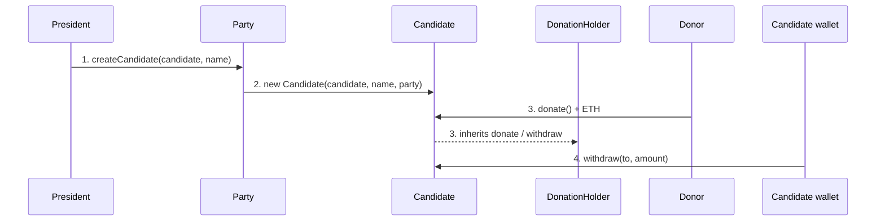
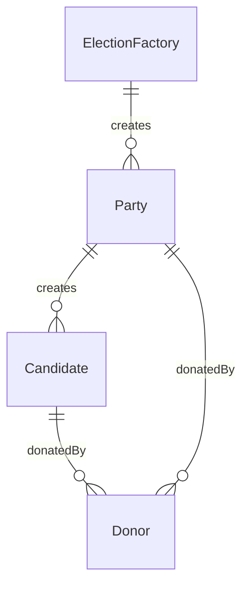

# Candidate

**Approved**: <pending>
**Settled mid-build:** none
**Review:** <pending>
**Fix pass:** <pending>

## Problem

Today a party exists, receives donations and has a president, but it has no candidates: there is no on-chain record of who runs for a party, and nobody can donate to a person instead of the whole party. Evidence: the request gives none beyond the ask.

When this ships, a party's president creates candidates for the party (name + the candidate's wallet); anyone sees them on the party page and donates to a candidate; the candidate's own wallet withdraws what was donated to them.

## Shape

Reuses `IDonatable`, `Ownable2Step`, the `Party` donation and withdraw code (moved to a shared base instead of copied), the factory-trust pattern (`isParty`/`isCandidate` mappings, `new` from the creator, list getter), and in the frontend the `parties/` feature folder, `DonateCard`, `WithdrawCard`, `runTransaction`. Every rule lives in Solidity and is covered by the Solidity tests in `packages/contracts/test/`; the frontend rules (form validation, who sees the withdraw form, trust check) are pure functions in `src/parties/` covered by vitest in `packages/frontend/test/`.

1. president calls `createCandidate(candidate, name)` -> `Party` (exists) - validates, deploys `Candidate`, records it, emits `CandidateCreated`
2. `Party` (exists) -> `Candidate` (new) - constructor sets the candidate wallet as owner, the name and the party
3. donor calls `donate()` with ETH -> `Candidate` (new) via `DonationHolder` (door 1) - same rules as `Party`
4. candidate calls `withdraw(to, amount)` -> `Candidate` (new) via `DonationHolder` (door 1)
5. `Party` (exists) now extends `DonationHolder` (new) - `donate`, `donatedBy`, `withdraw`, `renounceOwnership` move there with the same signatures, errors and events
6. reader opens `/parties/:address` -> `Party` route (exists) - also reads `Party.candidates()` and lists them; president sees "Criar candidato" (`CreateCandidateCard`, new)
7. reader opens `/candidates/:address` -> `Candidate` route (new) - reads `party()`, checks `factory.isParty(party)` and `Party.isCandidate(address)`, then `name`, `owner`, balance, `donatedBy(account)`; `DonateCard`/`WithdrawCard` (exist) are parametrized by target contract

**Changes underneath**

| Front | What changes |
| --- | --- |
| domain | "candidato" is a new term; `Election.candidates` (strings) is unrelated and untouched |
| stored data | nothing to migrate; `Party` gains `_candidates` and `isCandidate`. `Party` and `ElectionFactory` have new bytecode, so the factory must be redeployed and `VITE_FACTORY_ADDRESS` updated (operator action) |
| readers | party page gains a candidates section; new `/candidates/:address`; `abis.ts` gains `candidateAbi` and `Party` entries; contract error messages gain `InvalidCandidate`, `EmptyCandidateName` |

New: `Candidate` (name, party, owner = candidate wallet, donatedBy per donor), `DonationHolder`; `Party` -> `Candidate` relation. One-way constraints: `Candidate` constructor `(address candidate, string name, address party)` (door 2).

## Surface

Contract calls (200 success, 403 revert for a caller who may not call, 400 other revert) and SPA routes.

| Route | In | Out | Status | Who |
| --- | --- | --- | --- | --- |
| `Party.createCandidate(address candidate, string name)` | candidate, name | `Candidate` | 200; 403 `OwnableUnauthorizedAccount`; 400 `InvalidCandidate`, `EmptyCandidateName` | the president; others get 403 |
| `Party.candidates()` / `Party.isCandidate(address)` | - | `Candidate[]` / `bool` | 200 | anyone |
| `Candidate.donate()` payable | ETH | event `Donated` | 200; 400 `ZeroDonation` | anyone |
| `Candidate.withdraw(address to, uint256 amount)` | to, amount | event `Withdrawn` | 200; 403 `OwnableUnauthorizedAccount`; 400 `InvalidRecipient`, `InsufficientBalance`, `WithdrawFailed` | the candidate wallet; others get 403 |
| `/parties/:address` (candidates section, create form) | - | list; form | 200 | anyone; form only for the president |
| `/candidates/:address` | candidate address | candidate page | 200; "candidato não encontrado" screen when the trust check fails | anyone; withdraw form only for the owner |

## Landing

| One-way door | Literal shape | Alternative rejected |
| --- | --- | --- |
| Shared donation code | `abstract contract DonationHolder is IDonatable, Ownable2Step` with `donate`, `donatedBy`, `withdraw`, `renounceOwnership` | copying `Party`'s code into `Candidate` - two copies of money-handling code drift apart |
| Candidate deployment | `new Candidate(candidate, name, address(this))` from `Party.createCandidate` | EIP-1167 clone - `Ownable2Step` has no initializer, and candidates are not created in volume (same reason as `Party`) |

- Nothing else in this change is hard to reverse

## Criteria

### S1: The president creates a candidate and everyone sees it (P1)

**Acceptance Criteria**

1. WHEN the president calls `Party.createCandidate(candidate, name)` THEN the party SHALL deploy a `Candidate` whose `owner()` is `candidate`, `name()` is `name` and `party()` is the party, push it to `candidates()`, set `isCandidate` true and emit `CandidateCreated(candidate contract)`
2. IF a non-president calls `createCandidate` THEN the party SHALL revert with `OwnableUnauthorizedAccount`
3. IF `candidate` is `address(0)` THEN the party SHALL revert with `InvalidCandidate`
4. IF `name` is empty THEN the party SHALL revert with `EmptyCandidateName`
5. WHEN the same wallet or the same name is used for a second candidate THEN the party SHALL create it too (no uniqueness)
6. The `Party` ABI for `donate`, `donatedBy`, `withdraw`, `renounceOwnership` and the existing Party tests SHALL be unchanged by the move to `DonationHolder`
7. WHEN `pnpm export-abis` runs THEN `abis.ts` SHALL export `candidateAbi` and a `partyAbi` containing `createCandidate`, `candidates`, `isCandidate`
8. WHEN anyone opens `/parties/<address>` THEN the page SHALL show a "Candidatos" section with one row per `candidates()` entry: name, candidate wallet (`shortAddress`), balance (`formatEth`), link to `/candidates/<address>`
9. WHEN the party has no candidates THEN the section SHALL show the empty state "Nenhum candidato criado ainda."
10. IF reading the candidates fails THEN the section SHALL show an error message with a "Tentar de novo" button
11. WHILE the active account is the party's president the page SHALL show the "Criar candidato" form (wallet address, name); for any other account or no wallet it SHALL NOT be shown
12. WHEN the president enters a valid wallet and a name and clicks "Criar candidato" THEN the app SHALL send `createCandidate`, show the transaction toast and, once mined, the new candidate SHALL appear in the list
13. IF the wallet is not a valid address or is the zero address THEN the form SHALL show an error and not open the wallet; IF the name is empty or whitespace THEN it SHALL show "Informe o nome do candidato." and not open the wallet
14. IF `createCandidate` reverts with `InvalidCandidate` or `EmptyCandidateName` THEN the toast SHALL show a Portuguese message for each, and `contractErrorName` SHALL know both

### S2: Open a candidate and donate (P1)

**Acceptance Criteria**

15. WHEN a reader opens `/candidates/<address>` of a candidate created by a party of the factory THEN the page SHALL show name, a link to its party, the candidate wallet, balance (`formatEth`) and, with a connected wallet, "Você já doou" = `donatedBy(account)`
16. IF the address is not an address, or `factory.isParty(candidate.party())` is false, or `Party.isCandidate(address)` is false THEN the page SHALL show a "candidato não encontrado" screen and no donate form
17. WHEN any account calls `Candidate.donate()` with `msg.value` > 0 THEN the candidate SHALL add it to `donatedBy(donor)`, raise its balance and emit `Donated(donor, msg.value)`
    - 1 wei → accepted; 1 ETH then 2 ETH by one donor → `donatedBy` = 3 ETH
18. IF `donate()` is called with `msg.value` = 0 THEN the candidate SHALL revert with `ZeroDonation`
19. IF ETH is sent to a candidate without `donate()` (plain transfer or unknown calldata) THEN the candidate SHALL revert
20. WHEN a connected user enters an amount in ETH on the candidate page and clicks "Doar" THEN the app SHALL send `donate()` with that value, show the toast and, once mined, balance and "Você já doou" SHALL increase by the amount (same parsing as the party's donate form: "1,5" → 1.5 ETH; "0" or more than 18 decimals → error, wallet not opened)
21. WHILE no wallet is connected the donate button SHALL be disabled with "Conecte a carteira para doar." and the page SHALL still show all data

### S3: The candidate withdraws (P1)

**Acceptance Criteria**

22. WHEN the candidate wallet calls `Candidate.withdraw(to, amount)` with `amount` <= balance THEN the candidate SHALL send `amount` wei to `to`, emit `Withdrawn(to, amount)` and keep `donatedBy` unchanged
    - amount = balance → balance 0; amount = 0 → accepted; partial → remainder kept
23. IF a non-owner calls `Candidate.withdraw` (including the party's president, unless they are also the candidate wallet) THEN the candidate SHALL revert with `OwnableUnauthorizedAccount`
24. IF `amount` > balance THEN the candidate SHALL revert with `InsufficientBalance` (balance + 1 → revert)
25. IF `to` is `address(0)` THEN the candidate SHALL revert with `InvalidRecipient`
26. IF the ETH transfer to `to` fails THEN the candidate SHALL revert with `WithdrawFailed` and leave the balance unchanged
27. IF `renounceOwnership()` is called on a candidate THEN it SHALL revert with `RenounceDisabled`
28. WHILE the active account is the candidate's owner the candidate page SHALL show the "Sacar" form (destination, amount); for any other account or no wallet it SHALL NOT be shown
29. WHEN the owner submits a destination and an amount <= balance THEN the app SHALL send `withdraw(to, amount)`, show the toast and, once mined, the balance SHALL drop by the amount; the destination starts as the owner's address and "Sacar tudo" fills the exact balance
30. IF the destination is invalid or zero, or the amount is empty, invalid, zero or above the balance THEN the form SHALL show an error and not open the wallet

## Out of scope

| Excluded | Why |
| --- | --- |
| Candidate number, office, photo | user chose "Candidato sem número"; only name + wallet |
| Removing or editing a candidate | user did not choose it |
| Handing a candidate's wallet over (`transferOwnership`) in the UI | not requested; the contract inherits it from `Ownable2Step` |
| Linking candidates to elections (`Election.candidates`) | user chose no |
| Global candidates list / header tab, search | user chose party page + candidate page |
| ERC-20 donations, donor list, redeploy and `.env` update | not requested / operator action |

## Assumptions

| Assumption | Chosen default | Rationale | Confirmed? |
| --- | --- | --- | --- |
| Model | `Party` creates a `Candidate` contract, president only | user answer | y |
| Fields | name + wallet (owner); no number | user answers | y |
| Donations | candidate is `IDonatable` | user answer | y |
| Who withdraws | the candidate wallet (owner), not the president | user answer | y |
| Screens | candidates on the party page, `/candidates/:address` page | user answer | y |
| Election link | none | user answer | y |
| Duplicates | same wallet or name allowed | not requested | n |
| Candidate knows its party | `party` public immutable | needed for the trust check and the link back | n |
| `renounceOwnership` on Candidate | disabled, like Party | funds would be locked | n |
| Zero-amount withdraw (contract) | allowed; form does not offer it | same as Party | n |
| Language and style | pt-BR, existing design system, no new dependencies, works from 360px | project guidelines | n |
| Fictional names in tests | only fictional names (Alfa, Partido Beta, Candidato Um) | project memory | n |

**Open questions:** none - all resolved or logged above.

## Sources

- `.specs/features/candidate/request.md` - the request and the answers
- `.specs/features/party/plan.md`, `.specs/features/party-frontend/plan.md` - what this builds on
