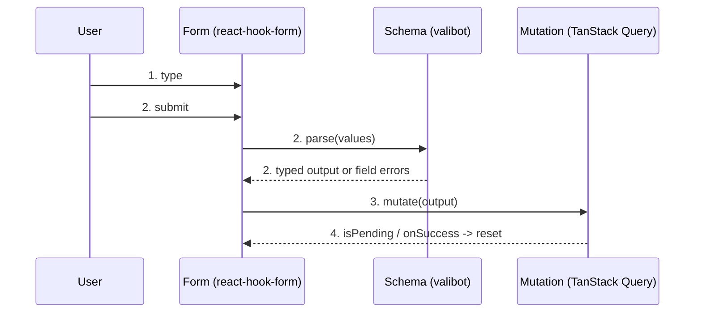
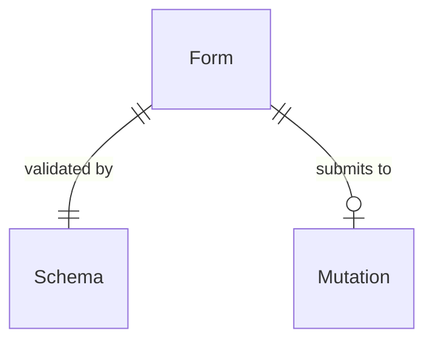

# Form library

**Approved**: 2026-11-22 - user: "pode construir"
**Settled mid-build:** none
**Review:** <pending>
**Fix pass:** <pending>

## Problem

`useFormState` types every field as `string` and returns the raw strings; the typed value (`bigint` wei, checksummed `Address`, Unix `bigint`) is only produced inside `validate*Form`, called by hand in each `onSubmit`. Seven forms repeat the same plumbing: `create-election` and `create-candidate` use the hook, `create-party` and `withdraw` copy its `useState` pair, and `donate`, `handover` and `authorize-voters` keep a bare `useState` plus one error string. Each has its own `FieldError`, `aria-invalid` and `aria-describedby` wiring, and each calls `mutate` with its own reset. Evidence: the request gives only the ask; the repo confirms the seven forms above.

When this ships, every form declares its fields, rules and submit in one shape: values are typed (input strings, output `bigint`/`Address`), errors and the submit state come from `react-hook-form`, and the transaction runs through the existing TanStack Query mutations.

## Shape

Reuses the existing mutations (`useCreateElection`, `useCreateCandidate`, `useCreateParty`, `useWithdraw`, `useDonate`, ...), `runTransaction` and the pt-BR messages already in the `validate*` functions; the rules that change an outcome (what is accepted, the error sentences) move into valibot schemas in `src/<feature>/` modules covered by vitest in `packages/frontend/test/`.

Evaluation findings the plan rests on:

- `react-hook-form` does not integrate with TanStack Query by itself: the integration is `handleSubmit((output) => mutation.mutate(output))`, with the mutation owning pending, server error and invalidation, and the form owning input state and validation. No adapter package exists or is needed.
- Inputs stay strings in the DOM (including `datetime-local`); the typing gain is the schema's output type (`v.InferOutput`), not the field type.
- Three rules depend on state outside the form: election dates on `now`, withdraw on the live balance and `holder`, voters on the already-authorized list. Schemas for these are built by a factory per submit (`electionFormSchema(nowSeconds)`), and the resolver reads the current context.
- Cost: `react-hook-form`, `@hookform/resolvers`, `valibot` (three dependencies, one-way); `useFormState` and the hand-written `FieldError` copies go away.

1. user edits a field -> `Form` field component (door 2) - `react-hook-form` `register`/`Controller` updates the value and clears that field's error
2. user submits -> `react-hook-form` `handleSubmit` - runs the form's valibot schema through the resolver (door 1); on failure shows the schema's pt-BR sentence at the field
3. valid output (typed) -> existing mutation hook (exists) - `mutate(output)`; `onSuccess` calls `reset()` (create-election resets to fresh defaults)
4. out: mutation `isPending` disables the button; blocked reasons (`reason`, wrong chain, no wallet) still disable it and never run the mutation

**Changes underneath**

| Front | What changes |
| --- | --- |
| domain | none |
| stored data | nothing to migrate |
| readers | the seven form cards; `validate*Form`, `parseAddress`, `parseEthAmount` and `parseVoterAddresses` either become schema pieces or stay as the parse step the schema calls; `use-form-state.ts` is deleted |

New: a `Form`/`FormField` helper in `src/components/` replacing the four copies of `FieldError`. One-way constraints: three new dependencies (door 1).

## Surface

None - nothing consumed outside.

## Landing

| One-way door | Literal shape | Alternative rejected |
| --- | --- | --- |
| Form library | `useForm<Input, Context, Output>({ resolver: valibotResolver(schema) })` + `handleSubmit(mutate)` | keeping `useState` per form: leaves seven copies of the plumbing; `@tanstack/react-form`: first-class TanStack but the user asked for `react-hook-form` |
| Schema library | `valibot` with `v.pipe(v.string(), v.transform(...))` per field | `zod`: ~15 kB+ against ~1-5 kB tree-shaken in an SPA that already ships viem and Semaphore |

- Nothing else in this change is hard to reverse

## Criteria

### S1: Create candidate on react-hook-form (P1)

The thinnest end to end form: dependencies, the field helper, one schema, one card, tests.

**Acceptance Criteria**

1. WHEN the president submits "Criar candidato" with name "Ana" and a valid wallet THEN the system SHALL call `createCandidate` once with the checksummed `Address` and the trimmed name, then empty both fields
2. IF the name is empty or only spaces THEN the system SHALL show "Informe o nome do candidato." at the name field and not call the mutation
   - "" → error; "   " → error; " Ana " → accepted as "Ana"
3. IF the wallet is not an address or is the zero address THEN the system SHALL show "Informe um endereço válido." or "O endereço zero não é permitido." at the wallet field
   - "0x123" → válido-error; `0x000…000` → zero-error; lowercase address → accepted, checksummed
4. WHEN the user edits a field with an error THEN the system SHALL clear that field's error and keep the other
5. WHILE the mutation is pending the system SHALL disable the submit button; WHILE the wallet is on the wrong chain it SHALL show "Troque a carteira para a <chain>." and disable it

### S2: Create election with typed dates (P1)

**Acceptance Criteria**

6. WHEN the authority submits valid title and dates THEN the system SHALL call `createElection` with `bigint` Unix seconds and the trimmed title, then reset to defaults computed at that moment
7. IF `nominationEnd`, `votingStart` or `votingEnd` break the rules of `validateElectionForm` THEN the system SHALL show the same sentences at the same fields
   - start 119 s ahead → error; 120 s ahead → accepted; end == start → error; nominationEnd after start → error
8. IF no voter is registered THEN the system SHALL show "Registre pelo menos um eleitor antes de criar a eleição." and not call the mutation

### S3: Party and withdraw forms (P2)

**Acceptance Criteria**

9. WHEN the factory owner submits "Criar partido" THEN the system SHALL behave as in 1-4 with the party messages ("Informe o nome do partido.", address messages)
10. IF the withdraw amount is above the live balance, zero, or has more than 18 decimals THEN the system SHALL show the sentence `validateWithdrawForm` gives today, using the balance at submit time
    - 1 wei over balance → error; exactly the balance → accepted; "1,5" → 1.5 ETH
11. WHEN a withdraw succeeds THEN the system SHALL clear only the amount and keep the destination

### S4: Donate, handover and authorize voters (P2)

**Acceptance Criteria**

12. WHEN the user submits an amount in "Doar" THEN the system SHALL send wei from `parseEthAmount` ("0,5" → 5e17) and clear the field; an invalid amount shows its sentence
13. WHEN the president submits a successor in "Transferir" THEN the system SHALL send the checksummed address; an invalid one shows "Informe um endereço válido."
14. WHEN the authority submits a list of voters THEN the system SHALL authorize only new, deduplicated, checksummed addresses and report invalid and already-authorized ones as `parseVoterAddresses` does today
15. WHEN S4 ships THEN `src/lib/use-form-state.ts` and every local `FieldError` copy SHALL be gone, and `pnpm frontend:test`, `pnpm frontend:build` and the repo lint pass

## Out of scope

| Excluded | Why |
| --- | --- |
| `@tanstack/react-form` | the request names `react-hook-form` |
| Changing any user-visible text, layout or field id | a library swap, not a redesign; ids feed the tests |
| Server-side error mapped to a field | contract errors already surface as toasts through the mutation `meta.errorTitle` |

## Assumptions

| Assumption | Chosen default | Rationale | Confirmed? |
| --- | --- | --- | --- |
| Scope | all seven forms | user: "Parecer + migrar os 7 formulários" | y |
| Validation | valibot schemas through `@hookform/resolvers` | user: "Adotar zod ou valibot", then "Valibot (Recommended)" | y |
| Validation timing | on submit, errors clear on edit (as today) | keeps current behaviour; `mode: "onSubmit"` | n |
| Existing `validate*` tests | kept as the proof of each rule, pointed at the schemas | rule 2: a test changes only with the claim it proves | n |

**Open questions:** none - all resolved or logged above.

## Differences from the source

None - the product matches the source

## Sources

- `packages/frontend/src/lib/use-form-state.ts` - the hook under evaluation
- the seven form cards under `packages/frontend/src/{authority,parties}/components/`
