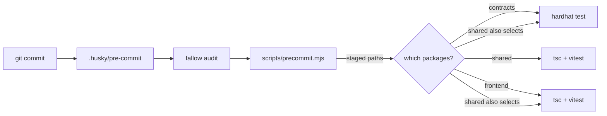
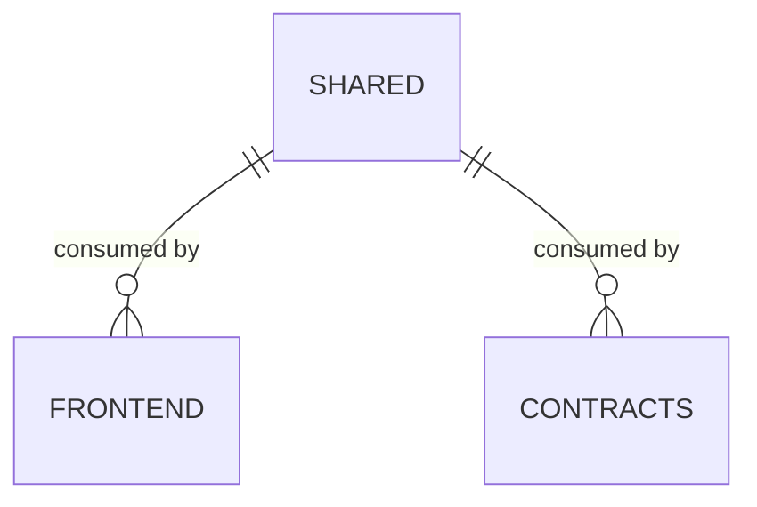

# Package pre-commit

**Approved**: 2026-11-22 - user: "implemente"
**Settled mid-build:** none
**Review:** sent at 58a1a58
**Fix pass:** done - `git diff --cached` now uses `--no-renames`, so moving files out of a package still selects it (finding 1, checked with a real `git mv` to `.specs/`); removed the empty `contracts/test/shared/` (2); the hook runs `pnpm scripts:test` when `scripts/` is staged (4); left unchanged: no automated test for `scripts/precommit.mjs` itself, i.e. the package list read from `package.json` and the exit code on failure (3, verified by hand in the review and in the build), and `pnpm-lock.yaml`/`pnpm-workspace.yaml` select no package, as criterion 9 says (5)

## Problem

A commit reaches `main` without any package's tests having run. The only gate is a `fallow audit` hook in `.git/hooks/pre-commit`, which is not versioned (a fresh clone has none) and checks dead code, not behaviour. The `@elections/shared` tests live inside `@elections/contracts/test/shared` (written for `node:test`, importing `../../../shared/*.js`), so the shared package has no tests of its own, no way to run them alone, and no way for a hook to tell that a change to shared needs them. Evidence: the request gives only the ask; the repo confirms the above (`git config core.hooksPath` is empty, `.git/hooks/pre-commit` is generated by `fallow hooks install`).

When this ships, every clone gets a pre-commit that runs `fallow audit` and then only the checks of the packages the commit touches (plus the packages that consume `shared`), and `@elections/shared` carries and runs its own tests.

## Shape

Reuses the pnpm workspace graph (`--filter`), the existing `hardhat test` and `vitest` runners and the existing fallow gate; the rules that change an outcome (which packages a staged file selects) live in a pure script under `scripts/` covered by vitest, not in shell inside `.husky/`.

1. `git commit` -> `.husky/pre-commit` (door 1) - runs `fallow audit` as the old hook did, then `node scripts/precommit.mjs`
2. `scripts/precommit.mjs` (door 2) - reads `git diff --cached --name-only`, maps files to packages by path prefix, adds the packages that depend on them (`@elections/shared` -> frontend, contracts), prints the selection
3. `pnpm --filter <pkg> precommit` (exists once each package declares it) - runs the package's check: contracts `hardhat test`; shared `tsc --noEmit` then `vitest run`; frontend `tsc --noEmit` then `vitest run`
4. out: exit 0 commits; any non-zero exit aborts the commit with that package's output

**Changes underneath**

| Front | What changes |
| --- | --- |
| domain | none |
| stored data | nothing to migrate; `core.hooksPath` becomes `.husky/_` for everyone who runs `pnpm install` (the `prepare` script); the old `.git/hooks/pre-commit` stops running |
| tests | `contracts/test/shared/*.test.ts` move to `packages/shared/test/` and change from `node:test` to `vitest`; `contracts` stops running them in `hardhat test` |
| imports | contracts integration tests import `@elections/shared` (declared `workspace:*`) instead of `../../../shared/index.js`, so the workspace graph shows contracts depends on shared |
| readers | `pnpm contracts:test` runs 169 Solidity + the remaining Node tests; a new root script `shared:test` runs the moved ones; `contracts/tsconfig.json` loses the `rootDir: ..` workaround if nothing needs it |

New: `.husky/pre-commit`, `scripts/precommit.mjs`, `packages/shared/{test,vitest config,tsconfig,scripts}`, a `precommit` script per package. One-way constraints: husky as dev dependency, `prepare` hook install (door 1).

## Surface

None - nothing consumed outside.

## Landing

| One-way door | Literal shape | Alternative rejected |
| --- | --- | --- |
| Hook manager | `husky` v9, `.husky/pre-commit`, root `"prepare": "husky"` | hand-copied `.git/hooks`: not versioned; `lefthook`: the user asked for husky |
| Package selection | `scripts/precommit.mjs` maps staged paths to packages and `pnpm --filter <pkg> precommit` runs each | filtering in shell inside `.husky/pre-commit`: nothing tests it |
| Per-package contract | each package exposes `"precommit"` in its own `package.json` | root script listing every command: the root would hold what belongs to each package |

- Nothing else in this change is hard to reverse

## Criteria

### S1: Shared owns and runs its tests (P1)

The tracer: `@elections/shared` gets vitest, `tsc` and its four test files, and contracts consumes it by package name.

**Acceptance Criteria**

1. WHEN `pnpm --filter @elections/shared test` runs THEN the system SHALL run `ballot`, `group`, `identity` and `timelock` tests with vitest and all pass
2. WHEN `pnpm --filter @elections/contracts test` runs THEN the system SHALL run the Solidity tests and the integration tests, and `contracts/test/shared/` SHALL not exist
3. WHEN the contracts integration tests run THEN they SHALL import `@elections/shared` and still pass
4. IF the shared `ballot` round-trip stops matching `abi.encode(uint256, bytes32)` THEN the shared tests SHALL fail
   - encode of `{option: 1n, salt}` → two 32-byte words, option first
5. WHEN `pnpm --filter @elections/shared precommit` runs THEN the system SHALL run `tsc --noEmit` then `vitest run`, failing if either fails

### S2: Per-package selection (P1)

**Acceptance Criteria**

6. WHEN the staged files are only under `packages/frontend/` THEN `scripts/precommit.mjs` SHALL select frontend only
7. WHEN a staged file is under `packages/shared/` THEN it SHALL select shared, frontend and contracts
8. WHEN a staged file is under `packages/contracts/` THEN it SHALL select contracts only
9. IF the staged files are only outside `packages/*` (e.g. `.specs/`, root config, `*.md`) THEN it SHALL select no package and exit 0
   - `.specs/x.md` → none; `packages/shared/x.ts` + `.specs/x.md` → shared, frontend, contracts; `packages/frontend/x.ts` + `packages/contracts/x.sol` → frontend, contracts
10. IF a selected package's check exits non-zero THEN the script SHALL stop with that exit code and name the package

### S3: Husky hook wired (P1)

**Acceptance Criteria**

11. WHEN `pnpm install` runs in a clone THEN `core.hooksPath` SHALL point to `.husky/_` through the `prepare` script
12. WHEN the user runs `git commit` THEN `.husky/pre-commit` SHALL run `fallow audit` first and `scripts/precommit.mjs` after, and a failure in either SHALL abort the commit
13. WHEN a commit touches only `packages/frontend/` THEN the hook SHALL run the frontend `tsc --noEmit` and `vitest run` and neither the contracts nor the shared checks
14. WHEN the frontend check is broken on purpose (a failing test) THEN `git commit` SHALL abort, and `git commit --no-verify` SHALL commit anyway
15. WHEN the docs describe the repo THEN `CLAUDE.md` root scripts SHALL list `shared:test` and mention the pre-commit, and `AGENTS.md` instructions SHALL stay true

## Out of scope

| Excluded | Why |
| --- | --- |
| Running the checks in CI (GitHub Actions) | the request names pre-commit only |
| A `pre-push` hook | not asked |
| Typecheck for `@elections/contracts` | answered: contracts runs only `hardhat test` |
| Replacing the Claude Code `fallow-gate` hook | independent of git hooks; stays |
| Making the drand tests offline | answered: moved as they are; `--no-verify` offline |

## Assumptions

| Assumption | Chosen default | Rationale | Confirmed? |
| --- | --- | --- | --- |
| fallow audit | kept first in `.husky/pre-commit` | user: "Manter no husky (Recommended)" | y |
| Dependents of shared | frontend and contracts run when shared is staged | user: "Sim, rodar dependentes (Recommended)" | y |
| Checks | tests + `tsc --noEmit` for frontend and shared; contracts `hardhat test` only | user: "Testes + typecheck" | y |
| drand tests | moved as they are | user: "Mover como está (Recommended)" | y |
| Dependents come from the pnpm graph | contracts declares `@elections/shared` as `workspace:*` and the script asks pnpm instead of a hand-written map; if node cannot load `.ts` through the workspace link, fall back to a map in the script | keeps one source of truth for who consumes shared | n |
| Selection scope | whole package runs (not just changed files) | the packages are small (frontend ~10 s, contracts ~15 s) | n |

**Open questions:** none - all resolved or logged above.

## Differences from the source

None - the product matches the source

## Sources

- `packages/contracts/test/shared/*.test.ts` - the tests to move
- `.git/hooks/pre-commit` - the fallow hook this replaces in the husky hook
