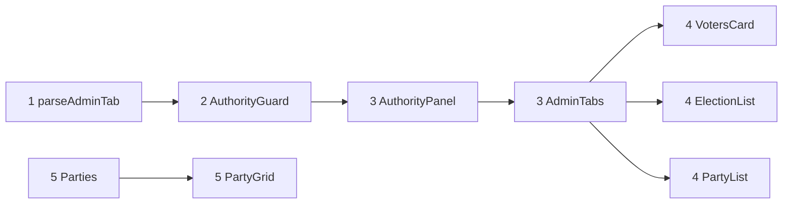
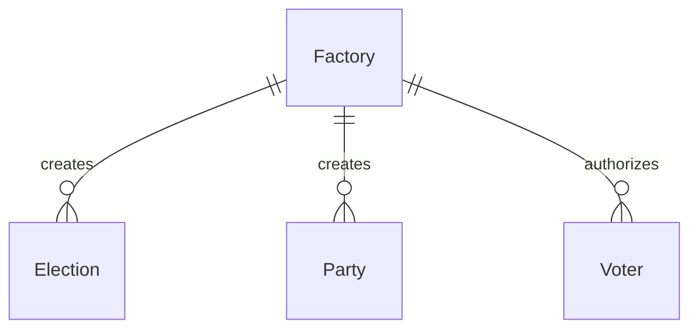

# Layout das páginas Autoridade e Partidos

**Approved**: 2026-11-22 - user: "Sim"
**Settled mid-build:** none
**Review:** pending
**Fix pass:** pending

## Problem

Na página da Autoridade, três formulários de assuntos diferentes (autorizar carteiras, criar eleição, criar partido) ficam empilhados numa coluna e a lista de eleitores, sem limite de altura, ocupa a outra; quem entra para uma tarefa rola por tudo e não vê o que já criou de eleições e partidos. Na página pública de Partidos, o mesmo texto "Partidos" aparece três vezes (eyebrow, título e título do card) e a lista fica dentro de um card que envolve tudo. Evidence: o pedido ("meio bagunçadas") não traz mais que isso; sem capturas.

Quando isto sair, a autoridade escolhe uma aba por assunto e vê só o formulário e a lista daquele assunto; quem abre Partidos vê uma grade de cards sem títulos repetidos.

## Shape

Reaproveita `PageHeader`, `StatCard`, `SectionCard`, `AuthorizeVotersCard`, `VotersCard`, `CreateElectionCard`, `CreatePartyCard`, `ElectionList`, `PartyList` e a busca `filterParties`. A regra que muda o resultado (qual aba abre, a partir da URL) é uma função pura em `src/authority/` coberta por vitest; ordenação e busca de partidos continuam em `filterParties`.

1. leitor abre `/admin?aba=<valor>` -> `parseAdminTab` (new) - devolve `eleitores`, `eleicoes` ou `partidos`; ausente ou inválido vira `eleitores`
2. `Admin` (exists) -> `AuthorityGuard` (exists) - mantém o bloqueio para quem não é a autoridade
3. `AuthorityPanel` (exists) - mostra as 3 métricas e `AdminTabs` (new), que lê e grava `aba` na URL
4. cada aba monta cards já existentes lado a lado: Eleitores = autorizar + `VotersCard`; Eleições = `CreateElectionCard` + `ElectionList`; Partidos = `CreatePartyCard` + `PartyList`
5. leitor abre `/parties` -> `Parties` (exists) - cabeçalho com busca e atualizar, e `PartyGrid` (new) no lugar de `PartyList` em linhas

**Changes underneath**

| Front | What changes |
| --- | --- |
| domain | none |
| stored data | nothing to migrate |
| readers | `/admin` (tabs) e `/parties` (grade); `PartyList` passa a ser usado também na aba Partidos da Autoridade ou é substituído por `PartyGrid` (decisão do builder, sem mudar critérios) |

New: nothing - read only (só apresentação).

## Surface

| Route | In | Out | Status | Who |
| --- | --- | --- | --- | --- |
| `/admin` | query `aba` = `eleitores`, `eleicoes` ou `partidos` | página da Autoridade com a aba escolhida | 200; `aba` inválida: 200 com `eleitores`; conta sem permissão: tela do `AuthorityGuard`, o equivalente a 403 numa SPA | só a autoridade; as outras contas veem a tela do `AuthorityGuard` (como hoje) |
| `/parties` | none | grade de partidos | 200 | anyone |

## Landing

None - só apresentação: nenhum dado, contrato ou dependência nova (as abas usam `radix-ui`, já instalado).

## Criteria

### S1: Autoridade em abas (P1)

A autoridade escolhe um assunto por aba e vê o formulário e a lista dele.

**Acceptance Criteria**

1. WHEN a autoridade abre `/admin` THEN the system SHALL mostrar as três métricas e as abas "Eleitores", "Eleições" e "Partidos", com "Eleitores" ativa
2. WHEN a autoridade clica na aba "Eleições" THEN the system SHALL mostrar `CreateElectionCard` e a lista de eleições, esconder o conteúdo das outras abas e mudar a URL para `/admin?aba=eleicoes`
   - "Partidos" → `?aba=partidos` com o formulário "Criar partido" e a lista de partidos; "Eleitores" → `?aba=eleitores` com "Autorizar carteiras" e "Eleitores"
3. IF a URL traz `aba` ausente ou fora de `eleitores`/`eleicoes`/`partidos` THEN the system SHALL abrir a aba "Eleitores"
   - `/admin` → eleitores; `/admin?aba=xyz` → eleitores; `/admin?aba=partidos` → partidos
4. WHEN a autoridade recarrega a página ou volta no navegador THEN the system SHALL manter a aba da URL
5. WHILE a aba "Eleições" mostra a lista, WHEN a autoridade cria uma eleição THEN the system SHALL mostrar o banner "Eleição criada." e a eleição nova no topo da lista (idem "Partido criado." na aba Partidos)
6. WHEN uma lista da aba (eleições ou partidos) não tem itens THEN the system SHALL mostrar o estado vazio que a página pública já mostra
7. WHILE a conta conectada não é a autoridade THEN the system SHALL mostrar a tela do `AuthorityGuard` e nenhuma aba
8. The system SHALL manter inalterados os nomes, rótulos e mensagens dos formulários e da lista de eleitores (testes de `admin.test.tsx` seguem verdes)

### S2: Partidos em grade (P1)

Quem abre Partidos vê uma grade de cards, sem título repetido.

**Acceptance Criteria**

1. WHEN alguém abre `/parties` THEN the system SHALL mostrar um único título "Partidos", a busca "Buscar partido", o botão "Atualizar partidos" e uma grade de cards, sem card envolvendo a página
2. The system SHALL mostrar em cada card o nome (ou "Partido #n" enquanto carrega), o presidente (`shortAddress`) e o saldo (`formatEth`, "…" enquanto carrega), e o card inteiro leva a `/parties/<endereço>`
3. The system SHALL ordenar os cards do partido mais recente para o mais antigo
4. WHILE a janela tem menos de 640px THEN the system SHALL mostrar 1 coluna; a partir de 640px, 2; a partir de 1024px, 3
5. WHEN a pessoa digita na busca THEN the system SHALL manter os partidos cujo nome, endereço ou presidente contém o texto (`filterParties`), e IF nenhum bate THEN mostrar "Nenhum partido encontrado."
6. IF a lista falha THEN the system SHALL mostrar "Não foi possível carregar os partidos." com "Tentar de novo"; WHILE carrega, "Carregando…"; IF não há partidos, "Nenhum partido criado ainda."
7. WHEN a pessoa clica em "Atualizar partidos" THEN the system SHALL reler os partidos e girar o ícone até terminar

## Out of scope

| Excluded | Why |
| --- | --- |
| Criar partido na página pública | o usuário escolheu a grade sem criação; criar fica na Autoridade |
| Tabela ordenável de partidos | alternativa não escolhida |
| Mudar outras páginas (Eleições, Registro, Sobre) | não pedido |
| Paginação das listas | não pedido |

## Assumptions

| Assumption | Chosen default | Rationale | Confirmed? |
| --- | --- | --- | --- |
| Parâmetro e valores da URL | `aba` = `eleitores`/`eleicoes`/`partidos` | português, como o resto da UI | n |
| Métricas continuam acima das abas, sempre visíveis | sim | mostradas no preview aprovado | y |
| Cabeçalho da Autoridade (eyebrow, título, texto) | permanece como está | não pedido | n |

**Open questions:** none - all resolved or logged above.

## Differences from the source

None - the product matches the source (sem fonte vinculante).

## Sources

- Pedido do usuário em `request.md` - binding - o que mudar
- Respostas do usuário: "Abas por assunto", "Grade de cards", "Na URL", "Sim, form + lista" - binding
