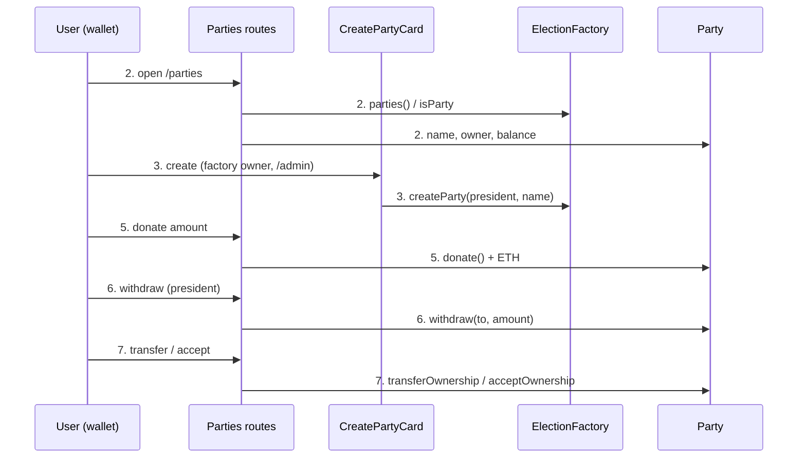
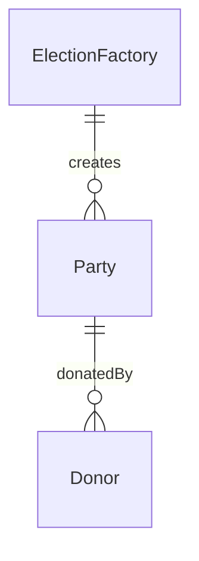

# Party frontend

**Approved**: 2026-11-20 - user: "aprovado, pode construir"
**Settled mid-build:** user: "você está utilizando nome de partidos reais. Não utilize em nenhum lugar" - tests, fixtures and spec examples use fictional names (Alfa, Partido Beta)
**Review:** sent at 9a380c7
**Fix pass:** done - added tests for the exact createParty error messages (criterion 9) and the exported ABIs (criterion 1); left unchanged: a party row whose own details fail to load keeps the "Partido #N" fallback and its link, since the page and the list still work and the plan asks for an error only on the list read

## Problem

The `Party` contracts exist (feature `.specs/features/party/`) but nothing in the app reaches them: the factory owner cannot create a party, nobody can see parties or donate, and a president cannot withdraw or hand over the presidency without calling the contract by hand. Evidence: the request gives none beyond the ask.

When this ships, anyone can browse parties and donate from the app; the factory owner creates parties in the Authority tab; a president withdraws funds and hands over the presidency from the party page.

## Shape

Reuses the app's feature-folder pattern (`factory/`, `elections/`), `runTransaction` for every write, `SectionCard`/`PageHeader`/`StatCard`, the factory-trust check (`isParty`) like `isElection`, and `AuthorityGuard`'s owner gate. Every rule that changes an outcome (who is president, who may accept, parsing and bounding the ETH amount) is a pure function in `src/parties/` covered by vitest in `packages/frontend/test/`; the contracts' own rules stay in the Solidity tests.

1. `pnpm export-abis` -> `electionFactoryAbi` gains `createParty`/`parties`/`isParty`/`PartyCreated`, and `partyAbi` is new (exists: `scripts/export-abis.ts` gains one entry)
2. reader opens `/parties` -> `Parties` route (new) - reads `ElectionFactory.parties()` and each party's `name`, `owner`, balance, lists them with search
3. owner submits the form in `/admin` -> `CreatePartyCard` (new) - `runTransaction` of `createParty(president, name)`, then refreshes the list
4. reader opens `/parties/:address` -> `Party` route (new) - checks `isParty` on the factory, reads `name`, `owner`, `pendingOwner`, balance and `donatedBy(account)`
5. donor submits an amount -> `Party.donate()` (exists) with `value`
6. president submits `to` and amount -> `withdraw(to, amount)`; "Sacar tudo" fills the whole balance
7. president names a successor -> `Party.transferOwnership` (exists); the pending account clicks accept -> `Party.acceptOwnership` (exists)

**Changes underneath**

| Front | What changes |
| --- | --- |
| domain | nothing renamed; "partido" and "presidente" are new terms in the UI |
| stored data | nothing to migrate; `abis.ts` is regenerated; the deployed `ElectionFactory` must be redeployed (it has new bytecode) and `VITE_FACTORY_ADDRESS` updated |
| readers | header nav gains "Partidos" for everyone; `/admin` gains a card; contract error messages gain the Party errors |

New: nothing stored by the app; read-only views over `Party`. One-way constraints: none.

## Surface

Routes of the SPA; "403" is the on-screen state for a caller who may not act.

| Route | In | Out | Status | Who |
| --- | --- | --- | --- | --- |
| `/parties` | - | list of parties | 200 | anyone |
| `/parties/:address` | party address | party page | 200; `not found` screen when `isParty` is false | anyone; withdraw and handover forms only for the president, accept only for the pending president |
| `/admin` create-party card | president, name | tx | 200; non-owners get the `AuthorityGuard` screen (403 equivalent) | factory owner |

## Landing

| One-way door | Literal shape | Alternative rejected |
| --- | --- | --- |
| Route shape | `/parties` and `/parties/:address` (mirrors `/` and `/elections/:address`) | `/party/:address` - singular breaks the plural collection pattern already used |

- Nothing else in this change is hard to reverse

## Criteria

### S1: See parties and create one (P1)

The factory owner creates a party in the Authority tab; anyone sees it in a new Partidos tab.

**Acceptance Criteria**

1. WHEN `pnpm export-abis` runs THEN `abis.ts` SHALL export `partyAbi` and an `electionFactoryAbi` that contains `createParty`, `parties`, `isParty`
2. WHEN anyone opens "Partidos" in the header THEN the app SHALL show `/parties` with one row per `parties()` entry: name, president (`shortAddress`), balance (`formatEth`), a link to `/parties/<address>`
3. WHEN the list has no parties THEN the page SHALL show an empty state with the sentence "Nenhum partido criado ainda."
4. WHEN a reader types in the search box THEN the list SHALL keep the parties whose name, address or president contains the text, case-insensitive
   - "alfa" matches "Alfa" and "Partido Alfa"; president address fragment matches; no match → empty state "Nenhum partido encontrado."
5. IF reading the list fails THEN the page SHALL show an error message with a "Tentar de novo" button
6. WHEN the factory owner enters a president address and a name in the Authority "Criar partido" card and clicks "Criar partido" THEN the app SHALL send `createParty`, show the transaction toast and, once mined, the new party SHALL appear in `/parties`
7. IF the president address is not a valid address THEN the card SHALL show an error and not open the wallet; IF the name is empty or whitespace THEN the card SHALL show "Informe o nome do partido." and not open the wallet
8. WHEN a non-owner opens `/admin` THEN the existing `AuthorityGuard` screen SHALL show (the new card is not visible)
9. IF `createParty` reverts with `InvalidPresident` or `EmptyPartyName` THEN the toast SHALL show a Portuguese message for each, and `contractErrorName` SHALL know `InvalidPresident`, `EmptyPartyName`, `ZeroDonation`, `InvalidRecipient`, `InsufficientBalance`, `WithdrawFailed`

### S2: Open a party and donate (P1)

**Acceptance Criteria**

10. WHEN a reader opens `/parties/<address>` of a party created by the factory THEN the page SHALL show name, president, balance (`formatEth`) and, with a connected wallet, "Você já doou" = `donatedBy(account)`
11. IF the address is not a party of the factory (`isParty` false) or is not an address THEN the page SHALL show a "partido não encontrado" screen and no donate form
12. WHEN a connected user enters an amount in ETH and clicks "Doar" THEN the app SHALL send `donate()` with that value, show the transaction toast and, once mined, the balance and "Você já doou" SHALL increase by the amount
    - "0.5" → 0.5 ETH; "1,5" → 1.5 ETH (comma accepted)
13. IF the amount is empty, not a decimal number, zero or negative THEN the form SHALL show an error and not open the wallet
    - "0" → error; "-1" → error; "abc" → error; "0.000000000000000001" → accepted (1 wei); more than 18 decimals → error
14. WHILE no wallet is connected the donate button SHALL be disabled with the reason "Conecte a carteira para doar." and the page SHALL still show all data

### S3: President withdraws (P1)

**Acceptance Criteria**

15. WHILE the active account is the party's president the page SHALL show the "Sacar" form (destination, amount); for any other account or no wallet it SHALL NOT be shown
16. WHEN the president opens the form THEN the destination SHALL start as the president's own address
17. WHEN the president submits a destination and an amount <= balance THEN the app SHALL send `withdraw(to, amount)`, show the toast and, once mined, the balance SHALL drop by the amount
18. WHEN the president clicks "Sacar tudo" THEN the amount field SHALL be filled with the exact balance
    - balance 1.2345678 ETH → field shows 1.2345678 (not rounded like `formatEth`)
19. IF the destination is not a valid address, or is `0x0000000000000000000000000000000000000000`, THEN the form SHALL show an error and not open the wallet
20. IF the amount is empty, invalid, or greater than the balance THEN the form SHALL show an error and not open the wallet (balance + 1 wei → error; amount 0 → error; this form does not offer a zero withdraw)

### S4: Presidency handover (P2)

**Acceptance Criteria**

21. WHEN the president enters a valid address in "Passar a presidência" and confirms THEN the app SHALL send `transferOwnership` and, once mined, the page SHALL show "Presidente pendente: <address>" and the president SHALL stay the same
22. WHILE the active account equals `pendingOwner()` the page SHALL show "Aceitar a presidência"; WHEN clicked THEN the app SHALL send `acceptOwnership` and, once mined, the page SHALL show that account as president with the withdraw form
23. IF the new-president address is invalid or is the zero address THEN the form SHALL show an error and not open the wallet
24. WHEN a president handover completes THEN the former president SHALL no longer see the withdraw form

## Out of scope

| Excluded | Why |
| --- | --- |
| List of donors / donation history from `Donated` events | user chose "Total doado pela conta ativa" |
| Linking elections to parties | not requested |
| Changing contracts, deploy/Ignition module, redeploy and `.env` update | contracts are done; redeploy is an operator action |
| Renounce presidency | disabled in the contract |
| ERC-20 donations, refunds, caps | not requested |

## Assumptions

| Assumption | Chosen default | Rationale | Confirmed? |
| --- | --- | --- | --- |
| Screens | list tab + detail page; create in Authority | user answer | y |
| Handover UI | yes, on the party page | user answer | y |
| Donation display | balance and the active account's `donatedBy` only | user answer | y |
| Withdraw form | free destination (default own address) and amount, "Sacar tudo" | user answer | y |
| Who sees the Partidos tab | everyone, no wallet needed to read | like the Elections tab | n |
| Withdraw confirm dialog | none, the wallet confirmation is the confirm | funds go to a typed address; app has no confirm pattern for transactions | n |
| Language and style | pt-BR, existing design system, no new dependencies | project guidelines | n |
| Widths | works from 360px (phone) to desktop, like the other tabs | repo fixed horizontal overflow on narrow screens | n |
| Loading state | skeleton/"Carregando…" text, like the elections list | follows existing lists | n |

**Open questions:** none - all resolved or logged above.

## Sources

- `.specs/features/party-frontend/request.md` - the request
- `.specs/features/party/plan.md` - the contracts this builds on
- `packages/frontend/src/` - existing patterns (`factory/`, `elections/`, `routes/`)
