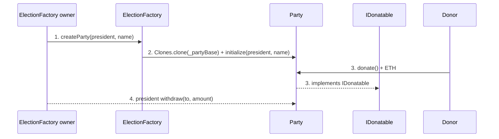
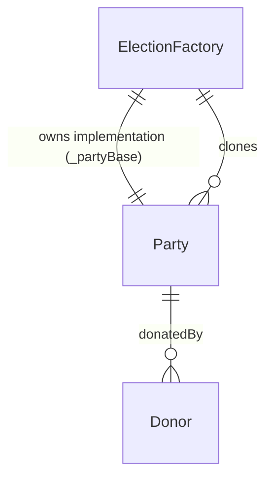

# Party

**Approved**: 2026-11-21 - user: "aprovado, implemente na worktree e depois realize o merge na main"
**Settled mid-build:** none
**Review:** stale - the spec changed after the review at 3366ef1 (Party is now a clone); review again after the rebuild
**Fix pass:** reset - the earlier pass (criterion 8 test) was against the `new Party` shape; redo after the rebuild

## Problem

Today the system has elections and voters but no entity that can receive money: nobody can donate to a political party, and no one is the accountable holder of funds. Evidence: the request gives none beyond the ask.

When this ships, the factory owner can create a Party with a president; any user can donate ETH to it; only the president can withdraw the funds.

## Shape

Reuses `ElectionFactory` (owner-gated creation, registry mapping + list, `renounceOwnership` disabled) and OpenZeppelin `Ownable2Step`. Like `Election`, `Party` is an EIP-1167 minimal proxy: the factory builds one `Party` implementation, clones it with `Clones.clone` and calls `initialize`. All rules live in Solidity and are covered by the existing Solidity tests in `packages/contracts/test/`.

1. owner calls `createParty(president, name)` -> `ElectionFactory` (exists) - validates president and name, clones the `Party` implementation, calls `initialize`, records the clone, emits `PartyCreated`
2. `ElectionFactory` (exists) -> `Party` (new) - `initialize(president, name)` sets president as owner and the name; runs once per clone
3. donor calls `donate()` with ETH -> `Party` (new) implementing `IDonatable` (new) - rejects zero value, adds to `donatedBy`, emits `Donated`
4. president calls `withdraw(to, amount)` -> `Party` (new) - sends ETH to `to`, emits `Withdrawn`
5. president calls `transferOwnership` / new president `acceptOwnership` -> `Party` (new) via `Ownable2Step`

**Changes underneath**

| Front | What changes |
| --- | --- |
| domain | nothing renamed; `Party` and `IDonatable` are new terms |
| stored data | nothing to migrate; factory gains `_partyBase` (immutable implementation, built in the factory like `_base` for `Election`), `_parties` list and `isParty` mapping; each party keeps its state in its own clone |
| readers | none yet (frontend out of scope) |

New: `Party` (name, president, donatedBy per donor), `IDonatable`. One-way constraints: `Party` is deployed as an EIP-1167 clone and is set up by `initialize(address president, string name)`, which cannot run twice; the implementation is locked with `_disableInitializers()` in its constructor, as `Election` does (door 2).

Ownership on a clone: the repo has only `@openzeppelin/contracts` 5.6.1 (no `contracts-upgradeable`), and `Ownable`'s constructor does not run on a clone, so a clone's `owner()` would be empty. Choice: `Party is Initializable, IDonatable, Ownable2Step`; the constructor runs `Ownable(msg.sender)` and `_disableInitializers()` (only the implementation's own storage is touched); `initialize` calls the internal `_transferOwnership(president)`, which `Ownable2Step` overrides to also clear `pendingOwner`. This keeps `owner`, `pendingOwner`, `acceptOwnership`, `onlyOwner` and the `OwnableUnauthorizedAccount` error as in the installed package, with no hand-written ownership code and no new dependency.

## Surface

Contract calls, so 200 means the call succeeds, 403 a revert for a caller who may not call it, 400 any other revert.

| Route | In | Out | Status | Who |
| --- | --- | --- | --- | --- |
| `ElectionFactory.createParty(address president, string name)` | president, name | `Party` | 200 success; 403 revert `OwnableUnauthorizedAccount`; 400 reverts `InvalidPresident`, `EmptyPartyName` | factory owner; others get 403 |
| `IDonatable.donate()` payable | ETH | event `Donated(donor, amount)` | 200 success; 400 revert `ZeroDonation` | anyone |
| `Party.withdraw(address to, uint256 amount)` | to, amount | event `Withdrawn(to, amount)` | 200 success; 403 revert `OwnableUnauthorizedAccount`; 400 reverts `InvalidRecipient`, `InsufficientBalance`, `WithdrawFailed` | president; others get 403 |
| `ElectionFactory.parties()` / `isParty(address)` | - | `Party[]` / `bool` | 200 | anyone |

## Landing

| One-way door | Literal shape | Alternative rejected |
| --- | --- | --- |
| Donation abstraction | `interface IDonatable { event Donated(address indexed donor, uint256 amount); error ZeroDonation(); function donate() external payable; }` | abstract contract with shared state - nothing is shared between implementers beyond the signature |
| Party deployment | `Clones.clone(_partyBase)` then `party.initialize(president, name)` from the factory, with `Party` using `Initializable` (`initializer`) and `_disableInitializers()` in its constructor | `new Party(president, name)` - simpler, but each party would cost a full deployment and `Party` would diverge from how `Election` is deployed (user asked for Clones + initialize) |

- Nothing else in this change is hard to reverse

## Criteria

### S1: Create a party and donate to it (P1)

The factory owner creates a Party and a donor sends ETH to it.

**Acceptance Criteria**

1. WHEN the factory owner calls `createParty(president, name)` THEN the factory SHALL clone the `Party` implementation and initialize it, so that the new `Party` has `owner()` equal to `president` and `name()` equal to `name`, push it to `parties()`, set `isParty` true and emit `PartyCreated(party)`
2. IF a non-owner calls `createParty` THEN the factory SHALL revert with `OwnableUnauthorizedAccount`
3. IF `president` is `address(0)` THEN the factory SHALL revert with `InvalidPresident`
4. IF `name` is empty THEN the factory SHALL revert with `EmptyPartyName`
5. WHEN any account calls `donate()` with `msg.value` > 0 THEN the party SHALL add it to `donatedBy(donor)`, increase its balance by `msg.value` and emit `Donated(donor, msg.value)`
   - 1 wei → accepted; two donations of 1 and 2 ETH by the same donor → `donatedBy` = 3 ETH
6. IF `donate()` is called with `msg.value` = 0 THEN the party SHALL revert with `ZeroDonation`
7. IF ETH is sent to a party without calling `donate()` (plain transfer or unknown calldata) THEN the party SHALL revert
8. The `Party` SHALL implement `IDonatable`, and `IDonatable` SHALL declare `donate()`, `Donated` and `ZeroDonation`
9. IF `initialize` is called on a party that was already initialized (including by the factory in `createParty`) THEN the party SHALL revert with `InvalidInitialization`, and `owner()` and `name()` SHALL stay unchanged
10. IF `initialize` is called on the `Party` implementation itself (the `_partyBase` the factory clones) THEN it SHALL revert with `InvalidInitialization`, so nobody can own or name the implementation
11. WHEN the factory owner calls `createParty` twice THEN the factory SHALL deploy two clones at distinct addresses, each with its own `owner()`, `name()`, `donatedBy` and balance, and neither address SHALL be the implementation's
   - party "Alfa" with president A and party "Partido Beta" with president B → donating to one leaves the other's balance at 0

### S2: President withdraws funds (P1)

**Acceptance Criteria**

12. WHEN the president calls `withdraw(to, amount)` with `amount` <= balance THEN the party SHALL send `amount` wei to `to`, emit `Withdrawn(to, amount)` and keep `donatedBy` unchanged
   - amount = balance → balance 0; amount = 0 → accepted, no transfer of value; partial amount → remaining balance kept
13. IF a non-president calls `withdraw` THEN the party SHALL revert with `OwnableUnauthorizedAccount`
14. IF `amount` > balance THEN the party SHALL revert with `InsufficientBalance` (balance, amount: balance + 1 → revert)
15. IF `to` is `address(0)` THEN the party SHALL revert with `InvalidRecipient`
16. IF the ETH transfer to `to` fails THEN the party SHALL revert with `WithdrawFailed` and leave the balance unchanged

### S3: Presidency handover (P2)

**Acceptance Criteria**

17. WHEN the president calls `transferOwnership(newPresident)` THEN `owner()` SHALL stay the current president and `pendingOwner()` SHALL be `newPresident` until `newPresident` calls `acceptOwnership()`
18. IF the former president calls `withdraw` after the handover completes THEN the party SHALL revert with `OwnableUnauthorizedAccount`
19. IF the president calls `renounceOwnership()` THEN the party SHALL revert with `RenounceDisabled`

## Out of scope

| Excluded | Why |
| --- | --- |
| ERC-20 donations | user chose ETH only |
| Frontend, ABI export, deploy module changes | user scoped to contracts |
| Linking elections to parties | not requested |
| Refunds, donation caps, donor anonymity | not requested |

## Assumptions

| Assumption | Chosen default | Rationale | Confirmed? |
| --- | --- | --- | --- |
| Asset | ETH only | user answer | y |
| Who creates, initial president | factory owner only, president is the address given | user answer | y |
| Withdraw form | `withdraw(to, amount)`, partial | user answer | y |
| Records | `Donated` event, `donatedBy`, immutable name, factory list + `isParty` | user answer | y |
| Abstraction form | interface `IDonatable` (not abstract contract) | request allows either; no shared state to inherit | n |
| Deployment | EIP-1167 clone + `initialize`, like `Election` | user instruction: "O contrato deve usar Clones e initialize, assim como packages/contracts/ usa." | y |
| Ownership on the clone | `Ownable2Step` from `@openzeppelin/contracts` 5.6.1 with `_transferOwnership(president)` in `initialize`; no upgradeable package | only the non-upgradeable package is installed; `Election` uses only `Initializable` | n |
| Zero-amount withdraw | allowed | harmless, avoids extra error | n |
| `renounceOwnership` on Party | disabled, like the factory | funds would be locked forever | n |
| Name uniqueness / length | no uniqueness, only non-empty | not requested | n |
| Files | `contracts/Party.sol`, `contracts/IDonatable.sol`; tests in `test/Party*Test.sol` and `ElectionFactoryCreatePartyTest.sol` | follows repo layout | n |

**Open questions:** none - all resolved or logged above.

## Sources

- `.specs/features/party/request.md` - the request
- `packages/contracts/contracts/ElectionFactory.sol` - factory to extend (`Clones.clone(_base)` + `initialize` for `Election`)
- `packages/contracts/contracts/Election.sol` - `Initializable`, `_disableInitializers()` in the constructor
